<!-- _class: cover -->

PROYECTO FINAL · LDS1071 · KAGGLE S6E11

# Predicción probabilística de fraude con tarjetas de crédito

Del análisis exploratorio a la selección de representaciones, modelos y ensambles.

699 960 operaciones de entrenamiento · 40 candidatos · evaluación OOF

---

<!-- _class: text-final -->

01 · Problema

## ¿Qué queremos predecir?

Una transacción puede ser legítima o fraudulenta. Buscamos estimar su probabilidad de fraude.

$$\hat p(x)\approx P(Y=1\mid X=x),\quad Y\in\{0,1\}.$$

- **Entrada:** variables observadas de la transacción, sin usar el identificador.
- **Salida:** probabilidad entre 0 y 1 por cada fila de prueba.
- **Objetivo:** maximizar ROC AUC, métrica de Kaggle.
- **Decisión operativa:** convertir la probabilidad en una alerta sólo si se define un umbral.

---

<!-- _class: text-final -->

01 · Datos

## ¿Con qué información contamos?

| Conjunto | Observaciones | Etiqueta |
|---|---:|---|
| Entrenamiento | 699 960 | is_fraud (0/1) |
| Prueba | 299 984 | Desconocida |

**24 predictores:** 13 numéricos (monto, saldo, velocidad, riesgo, tiempo, etc.), 5 categóricos (comercio, tarjeta, autenticación, canal y dispositivo) y 6 booleanos (banderas de riesgo). El campo id sólo identifica filas.

---

<!-- _class: text-final -->

01 · Objetivo

## ¿Por qué ROC AUC y no exactitud?

$$\mathrm{AUC}=P(s(X^+)>s(X^-))+\tfrac12 P(s(X^+)=s(X^-)).$$

- **ROC AUC:** capacidad de ordenar fraudes por encima de legítimas.
- **Average precision (AP):** resume precisión–recall; referencia aleatoria = prevalencia.
- **Log loss / Brier:** evalúan probabilidades, no sólo ranking.
- **Recall, precisión y F1:** dependen de un umbral.

La exactitud puede ser engañosa cuando la clase positiva es rara.

---

<!-- _class: figure-final -->

02 · EDA

## Desbalance y valores faltantes

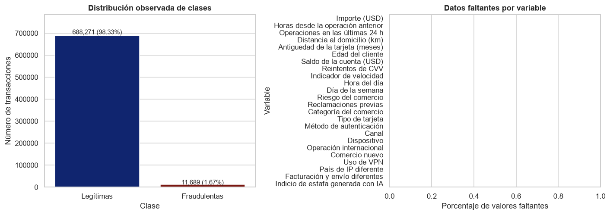

<h3>LECTURA</h3>
Distribución de is_fraud y porcentaje de faltantes.
<h3>RESULTADO</h3>
11 689 fraudes (1,67 %) y 688 271 legítimas (98,33 %). No se observan faltantes.
<h3>ALCANCE</h3>
Predecir siempre legítima da 98,33 % de exactitud pero recall cero.

---

<!-- _class: figure-final -->

02 · EDA

## Distribuciones numéricas

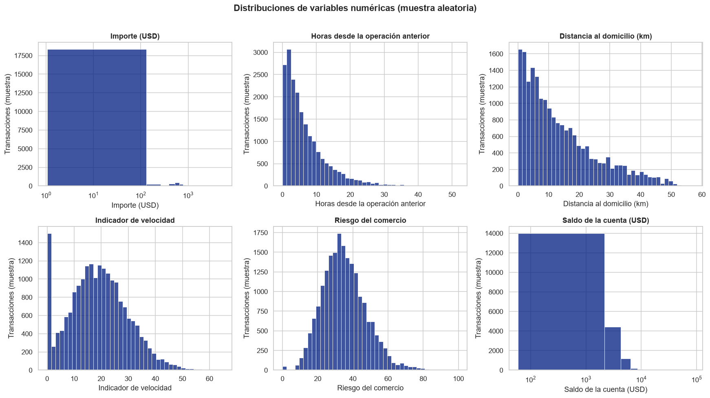

<h3>LECTURA</h3>
Histogramas de seis variables en una muestra.
<h3>RESULTADO</h3>
Monto, saldo y tiempo presentan asimetrías; velocidad y riesgo tienen otras escalas.
<h3>ALCANCE</h3>
No se eliminan automáticamente valores extremos.

---

<!-- _class: figure-final -->

02 · EDA

## Correlación de Spearman

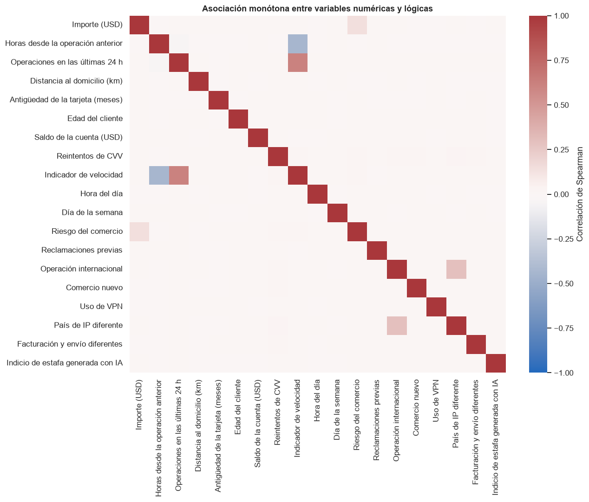

<h3>LECTURA</h3>
Asociación monótona de numéricas y booleanas.
<h3>RESULTADO</h3>
Predominan correlaciones bajas, con asociaciones localizadas.
<h3>ALCANCE</h3>
No descarta interacciones ni relaciones no monótonas.

---

<!-- _class: figure-final -->

02 · EDA

## Fraude por categoría y canal

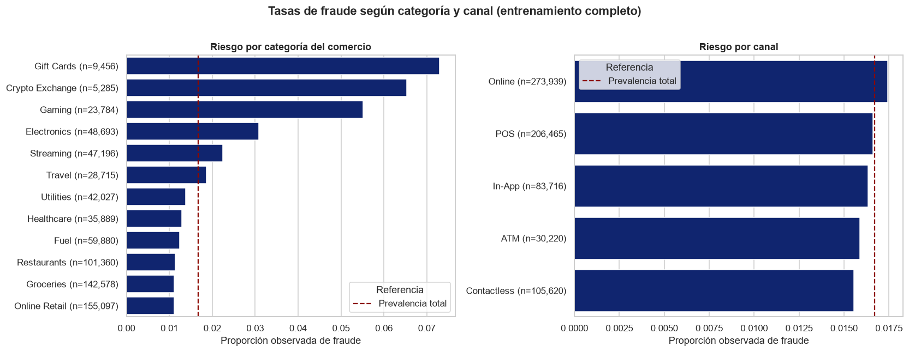

<h3>LECTURA</h3>
Tasas por grupo sobre el entrenamiento completo.
<h3>RESULTADO</h3>
Gift Cards, Crypto Exchange y Gaming muestran tasas superiores a la referencia; los canales varían menos.
<h3>ALCANCE</h3>
Interpretar con tamaños de grupo; no son efectos causales.

---

<!-- _class: figure-final -->

02 · EDA

## Relaciones no lineales

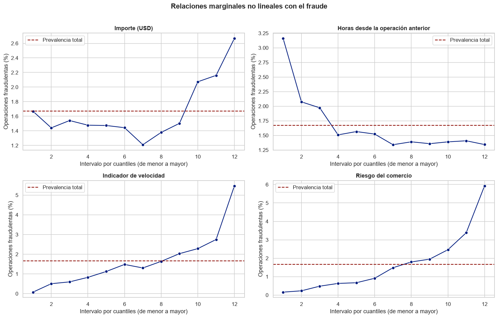

<h3>LECTURA</h3>
Tasas observadas por doce cuantiles.
<h3>RESULTADO</h3>
Velocidad y riesgo del comercio muestran aumentos pronunciados en los cuantiles altos.
<h3>ALCANCE</h3>
La tasa marginal no equivale a la relación multivariable.

---

<!-- _class: figure-final -->

02 · EDA

## Interacciones entre predictores

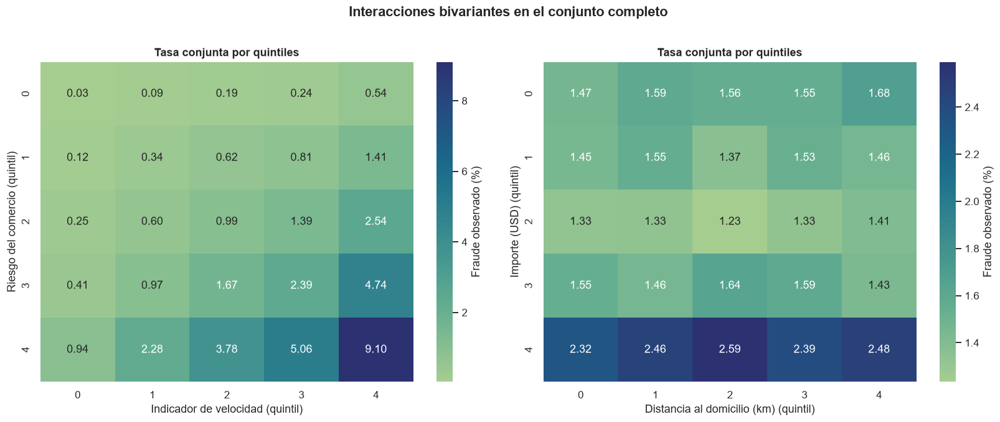

<h3>LECTURA</h3>
Tasas conjuntas por quintiles.
<h3>RESULTADO</h3>
La celda de mayor velocidad y riesgo comercial alcanza 9,10 % de fraude.
<h3>ALCANCE</h3>
Las interacciones motivan árboles; no prueban causalidad.

---

<!-- _class: figure-final -->

02 · EDA

## Anomalías multivariantes

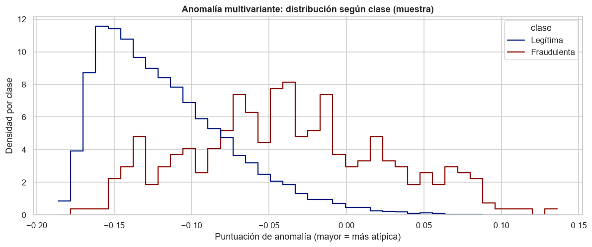

<h3>LECTURA</h3>
Distribución de puntuaciones de Isolation Forest por clase.
<h3>RESULTADO</h3>
Fraudes tienden a scores de anomalía mayores; existe solapamiento.
<h3>ALCANCE</h3>
Diagnóstico descriptivo, no predictor del pipeline.

---

<!-- _class: text-final -->

02 · EDA

## Del diagnóstico a las hipótesis

- Diferencias de escala → comparar estandarización con datos sin escalar.
- No linealidades e interacciones → comparar logística y árboles.
- Anomalías y vecindades → construir características geométricas mediante clustering.
- Desbalance → estratificación, ROC AUC y métricas de alertas.

**Las decisiones se contrastan mediante validación cruzada; el EDA no demuestra superioridad de ningún modelo.**

---

<!-- _class: text-final -->

03 · Pipeline

## El flujo metodológico del notebook

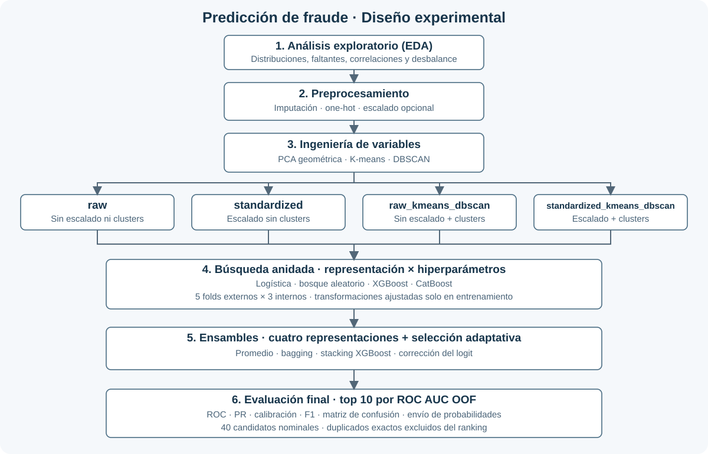

---

<!-- _class: text-final -->

03 · Preprocesamiento

## Imputación, one-hot y estandarización

$$z_j=\frac{x_j-\hat\mu_j}{\hat\sigma_j}.$$

- Numéricas: mediana y escalado opcional.
- Booleanas: 0/1 e imputación por moda.
- Categóricas: moda y one-hot encoding; niveles desconocidos ignorados.
- Raw conserva la escala original de numéricas, pero también usa one-hot.

**Todas las transformaciones se ajustan únicamente en el entrenamiento de cada split.**

---

<!-- _class: figure-final -->

03 · Geometría

## PCA: retener 90 % de la varianza

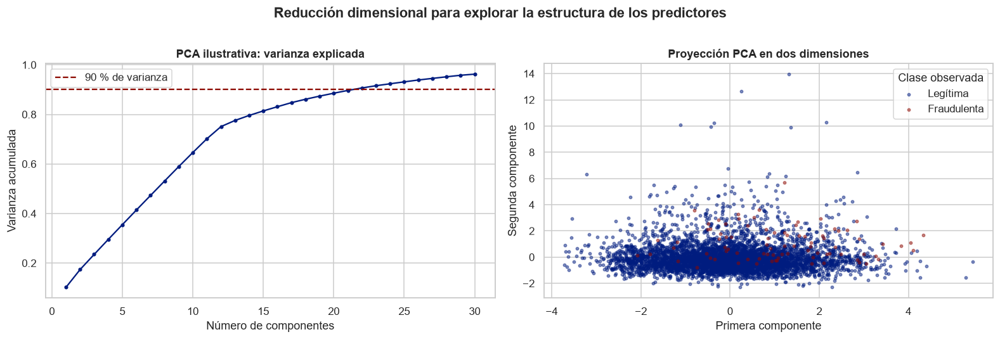

<h3>LECTURA</h3>
Varianza acumulada y proyección ilustrativa en dos dimensiones.
<h3>RESULTADO</h3>
Las clases se solapan; PCA 90 % permite construir distancias de clustering.
<h3>ALCANCE</h3>
Se reajusta por split; no es un quinto candidato de representación.

---

<!-- _class: text-final -->

03 · Ingeniería

## K-means: distancias a centroides

$$\min_{\mu_1,\ldots,\mu_k}\sum_i\min_j\|z_i-\mu_j\|_2^2.$$

- Geometría PCA sobre datos estandarizados; referencia de hasta 15 000 filas del entrenamiento.
- k = 5, 10 inicializaciones y semilla fija.
- Cinco distancias a centroides y una distancia mínima: **seis nuevas características**.
- Validación y prueba se transforman con centroides ya ajustados.

---

<!-- _class: text-final -->

03 · Ingeniería

## DBSCAN: densidad y ruido

$$d_{\rm core}(z)=\min_{c\in\mathcal C}\|z-c\|_2.$$

- Referencia de hasta 2 300 observaciones, min_samples = 5.
- ε: cuantil 90 % de la distancia al quinto vecino de referencia.
- Dos nuevas características: distancia al núcleo más cercano e indicador de distancia mayor que ε.
- Total: seis características K-means + dos DBSCAN.

No se crean transacciones sintéticas ni se eliminan columnas originales.

---

<!-- _class: figure-final -->

03 · Ingeniería

## Diagnósticos de clustering

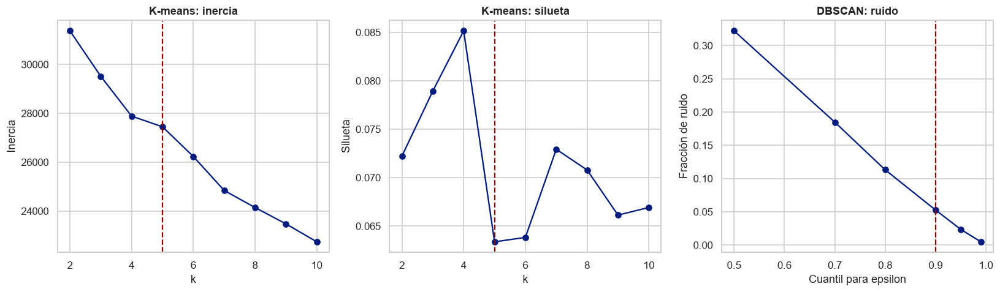

<h3>LECTURA</h3>
Inercia, silueta y proporción de ruido.
<h3>RESULTADO</h3>
La inercia decrece con k; la silueta no es monótona. El ruido baja al ampliar ε.
<h3>ALCANCE</h3>
k=5 y cuantil 0,90 son decisiones fijas, no óptimos demostrados.

---

<!-- _class: text-final -->

03 · Representación

## Diseño factorial: cuatro alternativas

| Representación | Escalado | One-hot | K-means + DBSCAN |
|---|:---:|:---:|:---:|
| raw | No | Sí | No |
| standardized | Sí | Sí | No |
| raw_kmeans_dbscan | No | Sí | Sí |
| standardized_kmeans_dbscan | Sí | Sí | Sí |

La geometría para clustering siempre está estandarizada; se escalan las distancias añadidas sólo en las ramas standardized. El indicador de ruido sigue binario.

---

<!-- _class: text-final -->

04 · Validación

## Validación cruzada anidada

- **5 folds externos** estratificados: cada operación recibe una predicción fuera de fold (OOF).
- **3 folds internos:** hasta 36 000 filas estratificadas del entrenamiento externo.
- Se reajustan imputación, one-hot, escalado, PCA y clusters dentro de cada split.
- Se eligen parámetros por AUC interna; refit en todo el entrenamiento externo.
- Para test, promedio de cinco probabilidades.

$$\hat p_i^{\rm OOF}=\hat f_{-k(i)}(x_i).$$

El fold externo permanece retenido; la selección final por OOF sigue siendo exploratoria.

---

<!-- _class: text-final -->

04 · Modelos

## Regresión logística

$$\hat p(x)=\sigma(\beta_0+x^\top\beta),\qquad\sigma(t)=\frac{1}{1+e^{-t}}.$$

- Regularización L2: C ∈ {0,01; 0,1; 1; 10}.
- Ponderación: None o balanced.
- Ocho configuraciones por representación.
- El escalado modifica el condicionamiento y la penalización.

La logística ofrece una base probabilística para la corrección posterior.

---

<!-- _class: figure-final -->

04 · Grilla

## Logística: efecto de la estandarización

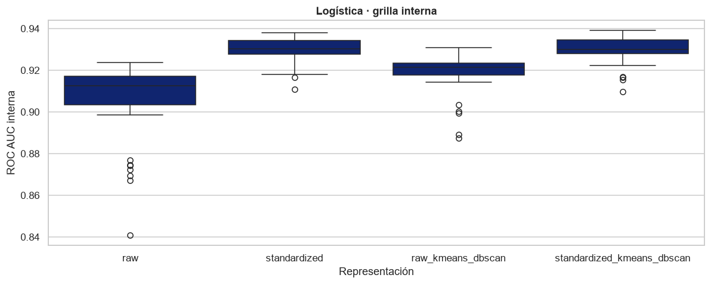

<h3>LECTURA</h3>
Distribución de AUC interna por representación.
<h3>RESULTADO</h3>
Las variantes estandarizadas muestran puntuaciones típicas más altas; raw presenta valores bajos dispersos.
<h3>ALCANCE</h3>
No es el ranking externo OOF.

---

<!-- _class: figure-final -->

04 · Grilla

## Bosque aleatorio: cuatro representaciones

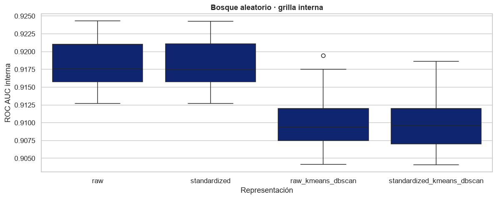

<h3>LECTURA</h3>
AUC interna de nueve configuraciones por representación.
<h3>RESULTADO</h3>
Las ramas sin clusters presentan medianas mayores en esta grilla.
<h3>ALCANCE</h3>
No demuestra un efecto causal ni sustituye al OOF.

---

<!-- _class: text-final -->

04 · Modelos

## XGBoost: boosting de árboles

$$F_m(x)=F_{m-1}(x)+\eta h_m(x),\quad \hat p(x)=\sigma(F_M(x)).$$

- 240 árboles; profundidad: 3, 5, 7, 10, 15, 30.
- Tasa de aprendizaje: 0,04; 0,08.
- min_child_weight: 5, 10, 15.

**6 × 2 × 3 = 36 configuraciones**; misma grilla en XGBoost individual, stacking y corrector de logits.

---

<!-- _class: figure-final -->

04 · Grilla

## XGBoost: cuatro representaciones

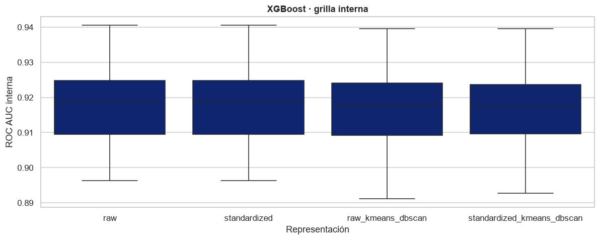

<h3>LECTURA</h3>
36 configuraciones por representación y fold.
<h3>RESULTADO</h3>
Amplio solapamiento de distribuciones internas; no se aprecia una ventaja clara del escalado.
<h3>ALCANCE</h3>
Los árboles pueden ser poco sensibles a escalas monótonas.

---

<!-- _class: figure-final -->

04 · Grilla

## CatBoost: cuatro representaciones

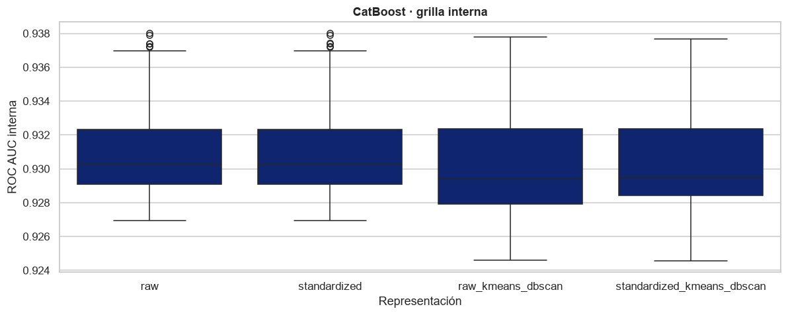

<h3>LECTURA</h3>
AUC interna de ocho configuraciones por representación.
<h3>RESULTADO</h3>
Medianas próximas; con clusters hay mayor dispersión inferior.
<h3>ALCANCE</h3>
No es una comparación OOF.

---

<!-- _class: text-final -->

04 · Búsqueda

## Espacio de búsqueda común

| Familia | Por representación | × 4 representaciones |
|---|---:|---:|
| Logística | 8 | 32 |
| Bosque aleatorio | 9 | 36 |
| XGBoost | 36 | 144 |
| CatBoost | 8 | 32 |
| **Total** | **61** | **244** |

244 × 3 folds internos × 5 externos = **3 660 ajustes internos nominales** de modelos individuales.

---

<!-- _class: text-final -->

04 · Búsqueda

## La representación es un hiperparámetro

$$(r^*,\theta^*)=\arg\max_{r,\theta}\frac13\sum_{j=1}^{3}\mathrm{AUC}_j(r,\theta).$$

- Por familia y representación: elegir mejor configuración interna.
- 4 familias × 4 representaciones = 16 candidatos fijos.
- Un selector adaptativo por familia: elige representación y parámetros por fold.
- 16 + 4 = **20 modelos individuales**.

Ninguna etiqueta de validación externa participa en la selección interna.

---

<!-- _class: text-final -->

05 · Ensambles

## Promedio y bagging

$$\hat p_{\rm promedio}=\tfrac14\sum_{j=1}^4\hat p_j,\quad\hat p_{\rm bagging}=\tfrac15\sum_{b=1}^5\hat p_b.$$

- **Promedio:** combinar las cuatro probabilidades de las familias seleccionadas.
- **Bagging:** cinco réplicas bootstrap de XGBoost, con reemplazo, usando parámetros seleccionados.
- Cuatro escenarios fijos y uno adaptativo.
- Reducir varianza no garantiza que aumente AUC.

---

<!-- _class: text-final -->

05 · Ensambles

## Stacking: aprender a combinar probabilidades

$$\hat p_{\rm stack}(x)=g(\hat p_{LR},\hat p_{RF},\hat p_{XGB},\hat p_{CAT}).$$

- El meta-modelo XGBoost recibe cuatro probabilidades.
- Cross-fitting para producir entradas OOF de meta-entrenamiento.
- Meta-validación con bases ajustadas únicamente en meta-entrenamiento.
- Misma grilla de 36 configuraciones.

La selección previa de las bases condiciona la evaluación interna; el fold externo sigue retenido.

---

<!-- _class: text-final -->

05 · Ensambles

## Logística + XGBoost: corregir el logit

$$\hat p(x)=\sigma\big(f_{\rm LR}(x)+g_{\rm XGB}(x)\big).$$

1. Elegir y ajustar la logística mediante AUC interna.
2. Usar su logit como **base_margin** en el ajuste XGBoost.
3. Evaluar las 36 configuraciones del corrector.
4. Pasar también base_margin en predicción; ambas etapas usan la misma representación.

No es stacking de probabilidades ni regresión de residuos explícitos.

---

<!-- _class: figure-final -->

05 · Grilla

## Corrección de logits: búsqueda de 36 boosters

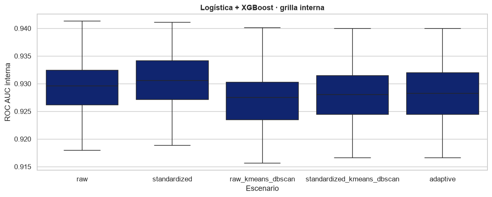

<h3>LECTURA</h3>
AUC interna por escenario.
<h3>RESULTADO</h3>
La rama standardized presenta mediana interna alta; el ranking OOF puede diferir.
<h3>ALCANCE</h3>
La selección final utiliza AUC OOF.

---

<!-- _class: text-final -->

05 · Ejecución

## 40 candidatos y aceleración

| Grupo | Candidatos |
|---|---:|
| 4 familias × 5 escenarios | 20 |
| 4 ensambles × 5 escenarios | 20 |
| **Total nominal** | **40** |

La corrida confirma XGBoost CUDA, CatBoost GPU, 32 hilos CPU y hasta 4 configuraciones CPU simultáneas. 9 060 ajustes internos nominales antes de reutilización, más auxiliares y refits. No hay benchmark temporal en el ZIP.

---

<!-- _class: figure-final -->

06 · Resultados

## Top 10 por ROC AUC OOF

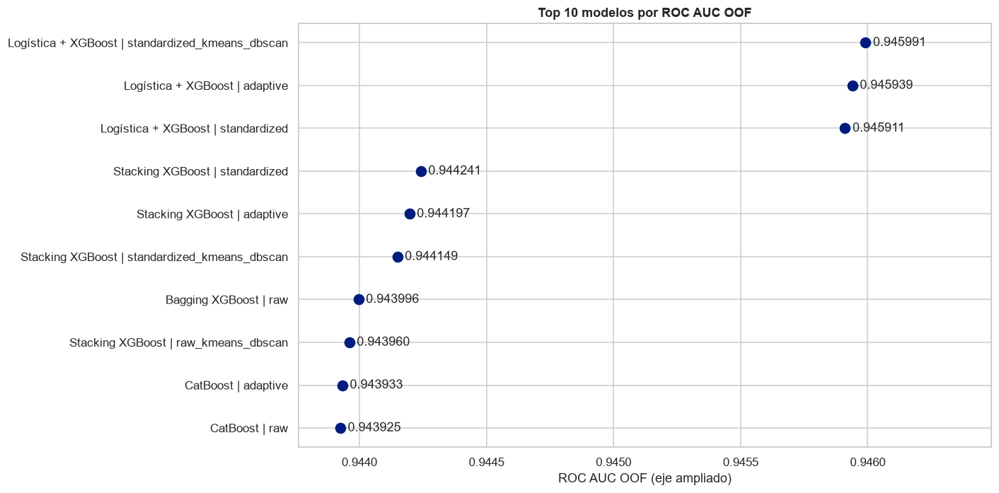

<h3>LECTURA</h3>
Ranking de 40 candidatos nominales, excluyendo duplicados exactos de predicciones.
<h3>RESULTADO</h3>
Tres correctores logísticos ocupan los primeros lugares; gana standardized_kmeans_dbscan.
<h3>ALCANCE</h3>
El eje está ampliado. No se dispone de IC nuevo.

---

<!-- _class: text-final -->

06 · Resultados

## Top 10: valores redondeados

<table class="compact"><thead><tr><th>#</th><th>Modelo</th><th>Representación</th><th>ROC AUC</th><th>AP</th></tr></thead><tbody><tr class="winner"><td>1</td><td>Logística + XGBoost</td><td>E + K + D</td><td>0,945991</td><td>0,507054</td></tr><tr><td>2</td><td>Logística + XGBoost</td><td>Adaptativa</td><td>0,945939</td><td>0,507165</td></tr><tr><td>3</td><td>Logística + XGBoost</td><td>E</td><td>0,945911</td><td>0,506537</td></tr><tr><td>4</td><td>Stacking XGBoost</td><td>E</td><td>0,944241</td><td>0,490959</td></tr><tr><td>5</td><td>Stacking XGBoost</td><td>Adaptativa</td><td>0,944197</td><td>0,489923</td></tr><tr><td>6</td><td>Stacking XGBoost</td><td>E + K + D</td><td>0,944149</td><td>0,489329</td></tr><tr><td>7</td><td>Bagging XGBoost</td><td>Raw</td><td>0,943996</td><td>0,496211</td></tr><tr><td>8</td><td>Stacking XGBoost</td><td>Raw + K + D</td><td>0,943960</td><td>0,488966</td></tr><tr><td>9</td><td>CatBoost</td><td>Adaptativa</td><td>0,943933</td><td>0,501852</td></tr><tr><td>10</td><td>CatBoost</td><td>Raw</td><td>0,943925</td><td>0,501742</td></tr></tbody></table>
E = estandarizada; K = K-means; D = DBSCAN. Fuente: top10.csv.

---

<!-- _class: text-final -->

06 · Resultados

## El finalista: ¿cuánto mejora?

0,945991 ROC AUC OOF

| Comparación | Diferencia AUC |
|---|---:|
| Contra logística + XGBoost estandarizada sin clusters | +0,000080 |
| Contra logística + XGBoost adaptativa | +0,000052 |

AP = 0,507054 · Log loss = 0,045837 · Brier = 0,011053.

El máximo nominal no demuestra superioridad estadística ni separa la contribución de K-means y DBSCAN.

---

<!-- _class: figure-final -->

06 · Evaluación

## ROC y precisión–recall

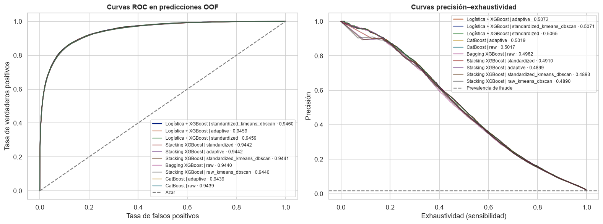

<h3>LECTURA</h3>
Predicciones OOF reales de los diez modelos.
<h3>RESULTADO</h3>
Las ROC casi coinciden; PR permite examinar la clase rara.
<h3>ALCANCE</h3>
La referencia PR aleatoria es 1,67 %; AUC no elige umbral.

---

<!-- _class: figure-final -->

06 · Evaluación

## Calibración de probabilidades

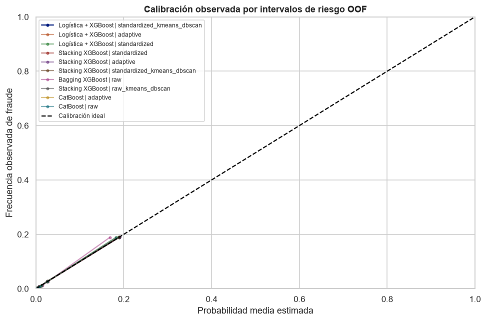

<h3>LECTURA</h3>
Frecuencia observada contra probabilidad media en 15 cuantiles.
<h3>RESULTADO</h3>
Puntos concentrados en probabilidades bajas; curvas próximas.
<h3>ALCANCE</h3>
No garantiza calibración en las colas ni estabilidad temporal.

---

<!-- _class: text-final -->

06 · Umbrales

## Tres políticas de alerta del finalista

| Política OOF | Umbral | Recall | Precisión | F1 | FN / FP |
|---|---:|---:|---:|---:|---:|
| 0,50 | 0,5000 | 30,82 % | 75,43 % | 0,4376 | 8 087 / 1 173 |
| Máximo F1 | 0,2510 | 46,11 % | 54,67 % | 0,5003 | 6 299 / 4 469 |
| Recall 98 % | 0,002076 | 98,01 % | 3,59 % | 0,0693 | 233 / 307 241 |

Reducir fraudes omitidos eleva alertas falsas. Umbrales ajustados sobre OOF completo: resultados descriptivos.

---

<!-- _class: figure-final -->

06 · Evaluación

## Matriz de confusión: recall cercano al 98 %

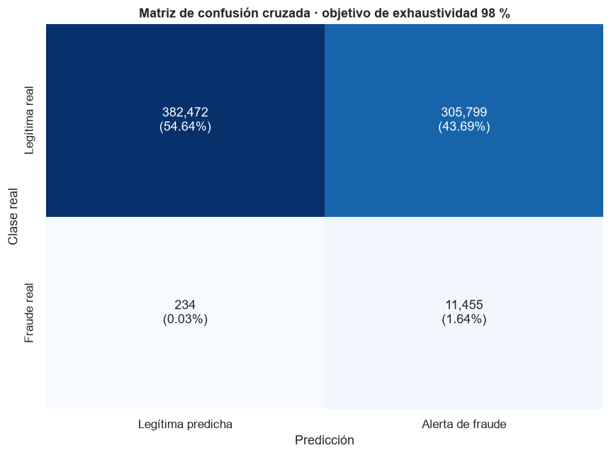

<h3>LECTURA</h3>
Umbral elegido en otros folds OOF y aplicado al fold retenido.
<h3>RESULTADO</h3>
11 455 VP, 234 FN, 305 799 FP y 382 472 VN. Recall 98,00 %; F1 0,06965.
<h3>ALCANCE</h3>
44,43 % de legítimas alertadas; no es validación independiente.

---

<!-- _class: text-final -->

07 · Cierre

## Entrega de probabilidades a Kaggle

- Finalista: Logística + XGBoost | standardized_kmeans_dbscan.
- 299 984 filas de prueba; columnas id,is_fraud.
- Probabilidades finitas entre 0 y 1, sin umbral.
- No hay score confirmado del leaderboard en el ZIP.

El archivo de predicciones individuales permanece privado.

---

<!-- _class: text-final -->

07 · Conclusiones

## Conclusiones y trabajo futuro

- Se evaluó el preprocesamiento y la ingeniería como parte del espacio de hiperparámetros.
- Ganador nominal: logística estandarizada + K-means + DBSCAN + XGBoost, AUC 0,945991.
- Tres variantes del corrector ocupan los primeros puestos; la ventaja sobre la estandarizada sin clusters es 0,000080.
- No hay IC nuevo, validación temporal ni score externo confirmado.
- Siguiente paso: bootstrap emparejado, ablación separada K-means/DBSCAN y análisis de costos.

**Selección reproducible; superioridad estadística aún no demostrada.**
